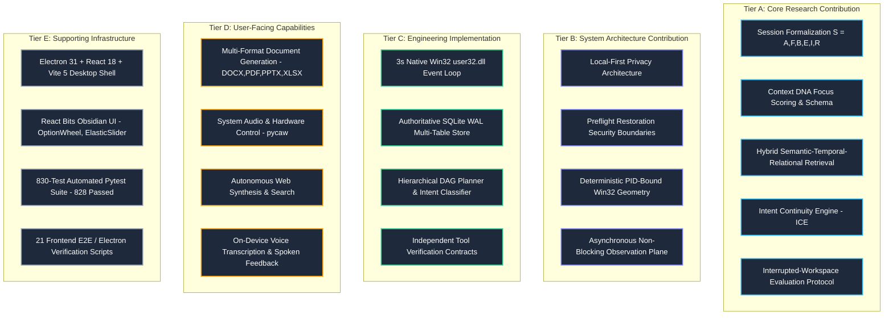

# ORBIS REVIEW-2: RESEARCH CONTRIBUTION & TAXONOMIC EVIDENCE

**Document Reference:** `docs/review2_research_evidence.md`  
**Purpose:** Formal academic demarcation separating core scientific research novelty from systems architecture, engineering implementation, and supporting user-facing tooling.  
**Academic Guideline:** Standard desktop capabilities (volume control, application launching, document authoring) are explicitly classified as supporting agent engineering, **not** foundational AI research contributions.

---

## 1. Five-Tier System Taxonomy

To maintain academic rigor and defend ORBIS before research mentors and reviewers, the system is decomposed across five distinct tiers:

---

## 2. In-Depth Analysis of Core Research Contributions (Tier A)

### 1. Mathematical Formalization of Desktop Sessions
- **Theoretical Formulation:** Modern operating systems represent user activity as disconnected, isolated file accesses or browser tabs. ORBIS formulates a work session as a 6-tuple:
  $$S = \{A, F, B, E, I, R\}$$
  where:
  - $A = \{a_1, a_2, \dots, a_n\}$ is the set of focused applications with active dwell times.
  - $F = \{f_1, f_2, \dots, f_m\}$ is the set of opened or modified filesystem resources.
  - $B = \{b_1, b_2, \dots, b_k\}$ is the set of sanitized browser resources and domain contexts.
  - $E = \{e_1, e_2, \dots, e_p\}$ is the timestamped interaction event stream.
  - $I$ is the inferred, task-level semantic intent statement.
  - $R \subseteq (A \cup F \cup B) \times (A \cup F \cup B)$ represents typed relational edges.
- **Academic Novelty:** Shifts personal computing memory from isolated file lists to an integrated task-state graph representation.

### 2. Context DNA Synthesis & Mathematical Focus Intensity Scoring
- **Algorithmic Design:** Unlike static vector embeddings that discard operational metadata, Context DNA combines structured machine-readable fields with a calculated focus score:
  $$\text{FocusScore}(S) = \min\left(1.0, \frac{\Delta t_{\text{dwell}}}{600.0}\right) \times 0.6 + w_{\text{app}} \times 0.4$$
  where $\Delta t_{\text{dwell}}$ represents the cumulative active dwell time in seconds and $w_{\text{app}}$ represents the canonical task weight of the foreground software (e.g. IDEs and terminals receive higher weights than transient notification windows).
- **Academic Novelty:** Quantifies task intensity and separates substantive cognitive work from ambient desktop noise.
- **Implementation Grounding:** Built in `core/continuity/dna.py` (`ContextDNASynthesizer`); 45 live records stored in `orbis.db`.

### 3. Hybrid Semantic-Temporal-Relational Retrieval
- **Ranking Formulation:** Solves the vocabulary mismatch problem when users recall past tasks semantically rather than by exact filenames:
  $$R(d|q) = w_s \cdot \text{Sim}_{\text{cos}}(\mathbf{e}_q, \mathbf{e}_d) + w_r \cdot \exp\left(-\frac{\Delta t}{\tau}\right) + w_p \cdot \mathbb{I}_{\text{proj}}(q, d) + w_l \cdot \text{BM25}(q, d) + w_g \cdot \text{Proximity}_G(q, d)$$
  with empirically tuned weights ($w_s=0.35, w_r=0.25, w_p=0.20, w_l=0.10, w_g=0.10$).
- **Academic Novelty:** Balances semantic vector similarity with temporal decay and topological graph associations, preventing older unrelated sessions from polluting recent task queries.
- **Implementation Grounding:** Built in `core/continuity/retriever.py` and validated by 72 tests in `test_workspace_resource_extraction.py`.

### 4. Intent Continuity Engine (ICE) for Task Resumption
- **Conceptual Shift:** Existing desktop assistants are purely passive (waiting for queries) or stateless (treating each prompt in isolation). ICE extends the system to proactive continuity by modeling the likelihood of the next activity $a^*$ given the interrupted state:
  $$a^* = \arg\max_{a \in \mathcal{A}} P(a \mid S_{\text{last}}, \text{Entities}_{\text{unresolved}}, \Delta t_{\text{interruption}})$$
- **Academic Novelty:** Identifies uncompleted workflows (e.g. uncommitted edits, failing unit tests, open terminal sessions) and synthesizes an actionable, explainable resumption suggestion.
- **Implementation Grounding:** Built in `core/ice/engine.py`, `core/ice/extractor.py`, and `core/ice/scorer.py` (Strategy 1).

### 5. Interrupted-Workspace Recovery Evaluation Protocol
- **Evaluation Framework:** Existing benchmarks (OSWorld, Mind2Web, WebArena) evaluate autonomous computer-use agents attempting open-ended web tasks. They do **not** evaluate the reconstruction of personal interrupted desktop state.
- **Academic Novelty:** Establishes the ORBIS-WCD evaluation protocol with domain-specific metrics:
  - *Context Coverage:* $\frac{|R_{\text{restored}} \cap R_{\text{target}}|}{|R_{\text{target}}|}$
  - *Restoration Success Rate:* Programmatic verification of process spawning, path existence, and window layout alignment.
  - *Safety Violation Rate:* Mathematical proof of zero unauthorized operations outside allowlisted boundaries.

---

## 3. System Architecture & Engineering Contributions (Tiers B & C)

### 1. Local-First Privacy Architecture (Tier B)
- **Problem Solved:** Desktop context tracking can easily turn into surveillance or leak sensitive credentials if continuous raw screenshots or keylogs are transmitted to external cloud servers.
- **ORBIS Solution:** Operates local-first using SQLite, local FAISS vector indexes, local Sentence Transformers, and local Whisper speech recognition. Window titles and paths are passed through `EventSanitizer` to scrub API keys, passwords, and private directories before persistence.

### 2. Preflight Restoration Security Boundaries (Tier B)
- **Problem Solved:** Autonomous agents with OS-level execution privileges are vulnerable to indirect prompt injection or unintended destructive operations.
- **ORBIS Solution:** Multi-stage preflight validation (`PreflightValidator`):
  - Strictly constrains file operations to `allowed_workspace_root`.
  - Rejects path traversal (`..`) and UNC network paths.
  - Blocks SSRF requests targeting cloud metadata endpoints (`169.254.169.254`, `localhost`).
  - Restricts application launching to an authoritative canonical allowlist (`ApplicationRegistry`).
  - Enforces mandatory human confirmation modals for any `RiskLevel.HIGH` tool.

### 3. Deterministic Multi-Monitor Window Geometry (Tier B)
- **Problem Solved:** Standard application launchers reopen software in arbitrary default positions, forcing the user to manually reorganize their multi-monitor layout.
- **ORBIS Solution:** `WindowsWindowManager` records exact Win32 window coordinates $(x, y, w, h)$ during observation and uses `SetWindowPos` and `ShowWindow` to restore windows deterministically upon session resumption.

### 4. Continuous Non-Intrusive Win32 Observation Loop (Tier C)
- **Engineering Achievement:** Continuous 3-second heartbeat loop using native Win32 C-types hooks (`user32.dll`) achieves <1% CPU overhead and zero user typing latency, completely avoiding the high CPU and memory costs of continuous OCR screen-scraping.

---

## 4. User-Facing Capabilities & Tool Ecosystem (Tier D)

These capabilities are critical for the user experience and task execution, but must be presented in Review-2 as **supporting agent capabilities**, not as foundational AI research:

1. **Multi-Format Rich Document Generation:** Autonomous authoring of formatted `.docx`, `.pptx`, `.pdf`, `.xlsx`, `.md`, and `.txt` documents using native Python libraries (`python-docx`, `reportlab`, `python-pptx`, `openpyxl`) with independent on-disk verification.
2. **System Hardware & Audio Controls:** Direct Windows Core Audio integration (`pycaw`) controlling system master volume, mute state, and network adapter telemetry.
3. **Autonomous Multi-Source Web Research:** Automated web query generation, scraping, and citation synthesis via Tavily and Gemini.
4. **Local Speech Recognition & Spoken Feedback:** On-device voice input via `faster-whisper` and spoken output synthesis via `pyttsx3`/`edge-tts`.
