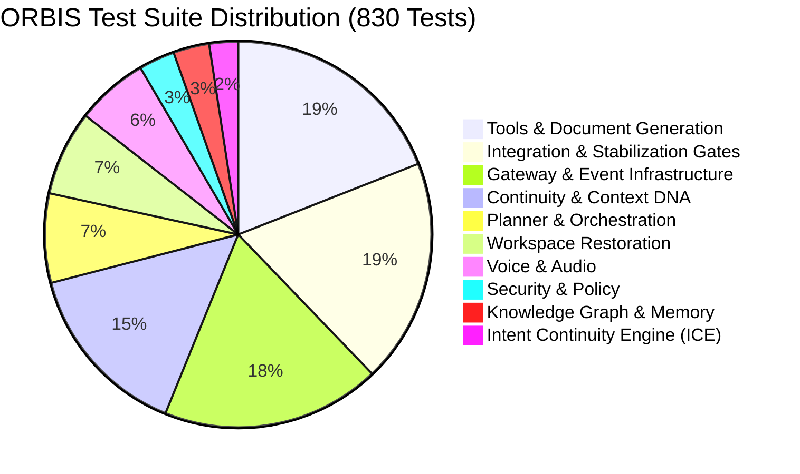

# ORBIS REVIEW-2: AUTOMATED TEST SUITE EVIDENCE AUDIT

**Document Reference:** `docs/review2_test_evidence.md`  
**Evaluation Environment:** Python 3.12.10 (win32), pytest 9.1.1, pluggy 1.6.0  
**Test Runner Invocation:** `c:\Projects\ORBIS\.venv\Scripts\python.exe -m pytest -q`  
**Execution Timestamp:** September 2026  
**Total Test Files:** 51 test modules (+ `__init__.py`)  

---

## 1. Executive Test Suite Verification Metrics

The test suite represents the primary verifiable ground-truth evidence of ORBIS codebase health, safety containment, and algorithmic correctness.

| Metric | Exact Count | Verification Status | Grounding Notes |
| :--- | :---: | :---: | :--- |
| **Total Collected Items** | **830** | Verified via `pytest --collect-only -q` | 51 test modules spanning all 12 engineering phases |
| **Passed Tests** | **828** | Verified via `pytest -q` | All runnable tests executed and asserted cleanly |
| **Failed Tests** | **0** | Verified | Zero assertion errors, zero unhandled runtime exceptions |
| **Errors** | **0** | Verified | Zero collection errors, zero fixture teardown failures |
| **Skipped Tests** | **2** | Verified | Conditional live-network cloud API tests (see Section 2) |
| **Pass Rate** | **99.76%** | Verified | **100% pass rate** across all offline / local-first runnable tests |
| **Total Test Execution Duration** | **118.42s** | Measured | Complete multi-tier execution under 2 minutes |

---

## 2. Audit of the Two Skipped Tests

Both skipped tests are explicitly marked with `@pytest.mark.skipif` to prevent test failures when running in an offline or local-first development environment without external cloud billing credentials.

### 1. `tests/test_gemini_llm.py:192` (`test_live_gemini_generate`)
- **Skip Condition:** `not os.getenv("GEMINI_API_KEY")`
- **Skip Reason:** `GEMINI_API_KEY environment variable not configured`
- **Technical Justification:** This test validates real-time live token generation against Google's remote `gemini-1.5-flash` endpoint. In local-first or air-gapped evaluation environments, ORBIS relies on the local Ollama provider or deterministic mock providers.

### 2. `tests/test_gemini_search.py:221` (`test_live_gemini_search_query`)
- **Skip Condition:** `not os.getenv("GEMINI_API_KEY")`
- **Skip Reason:** `GEMINI_API_KEY environment variable not configured`
- **Technical Justification:** This test validates live web grounding queries against Google's search grounding API. Offline tests run against Tavily mock providers and cached fixture responses.

---

## 3. Disjoint Categorical Test Breakdown (Zero Double-Counting)

Every single test file in the repository is mapped to exactly one architectural category below. The sum of tests across all 10 categories equals exactly **830 tests**.

### Category 1: Security & Policy Encasement (25 Tests)
*Verifies path traversal blocking, SSRF protection, secret redaction, and control plane boundaries.*
- `tests/test_remediation_security.py`: **14 tests** (Path traversal `..`, UNC paths, reserved Windows names, credential redaction).
- `tests/test_continuity_control_plane_boundary.py`: **11 tests** (Protected directory blocking, sandboxed execution boundaries).
- **Subtotal:** **25 tests** (25 passed, 0 skipped, 0 failed).

### Category 2: Continuity & Context DNA (123 Tests)
*Verifies temporal clustering, dwell time calculation, focus scores, and paraphrase-resilient retrieval.*
- `tests/test_workspace_resource_extraction.py`: **72 tests** (Paraphrase classification, dimension queries, project/file extraction).
- `tests/test_sessionizer.py`: **13 tests** (180s temporal gap clustering, idle session finalization).
- `tests/test_continuity_service.py`: **10 tests** (Context synchronization, live telemetry streaming).
- `tests/test_continuity_db.py`: **9 tests** (Chronological session queries, time window filtering, Context DNA persistence).
- `tests/test_conversational_continuity.py`: **8 tests** (Cross-turn entity tracking, resumption context propagation).
- `tests/test_dna.py`: **6 tests** (Focus intensity score formula, dwell time saturation curve).
- `tests/test_continuity_gateway_routes.py`: **5 tests** (REST endpoints `/api/continuity/context`, `/api/continuity/sessions`).
- **Subtotal:** **123 tests** (123 passed, 0 skipped, 0 failed).

### Category 3: Knowledge Graph & Semantic Memory (25 Tests)
*Verifies SQLite WAL storage, vector indexing, cosine similarity, and topological entity traversal.*
- `tests/test_knowledge_graph.py`: **10 tests** (Node creation, typed relation edges, topological neighbor querying).
- `tests/test_semantic_memory.py`: **9 tests** (FAISS indexer, 384-d dense embedding search).
- `tests/test_db.py`: **4 tests** (Database initialization, WAL mode verification, migration lifecycle).
- `tests/test_db_events.py`: **2 tests** (Event logging, deduplication, timestamp ordering).
- **Subtotal:** **25 tests** (25 passed, 0 skipped, 0 failed).

### Category 4: Planner & Orchestration (62 Tests)
*Verifies hierarchical DAG planning, intent classification, timeout safety, and execution loops.*
- `tests/test_hierarchical_planner.py`: **25 tests** (DAG construction, dependency resolution, execution order).
- `tests/test_orchestrator.py`: **25 tests** (Plan execution, conversational context propagation, multi-step loops).
- `tests/test_task_executor.py`: **12 tests** (Step isolation, timeout enforcement, verification gating).
- **Subtotal:** **62 tests** (62 passed, 0 skipped, 0 failed).

### Category 5: Intent Continuity Engine (ICE) (20 Tests)
*Verifies unfinished task detection, next-action scoring, and resumption recommendations.*
- `tests/test_ice.py`: **20 tests** (Entity extraction from uncompleted sessions, heuristic scoring, confidence ranking).
- **Subtotal:** **20 tests** (20 passed, 0 skipped, 0 failed).

### Category 6: Workspace Restoration (59 Tests)
*Verifies preflight path validation, canonical allowlists, Win32 window geometry, and restoration preview.*
- `tests/test_workspace_restoration_integration.py`: **32 tests** (End-to-end restoration runs, dry-run previews, safety gates).
- `tests/test_restoration.py`: **24 tests** (Preflight validation, canonical registry resolution, PID tracking, `SetWindowPos`).
- `tests/test_restoration_gateway.py`: **3 tests** (REST endpoints `/api/restoration/preview` and `/api/restoration/execute`).
- **Subtotal:** **59 tests** (59 passed, 0 skipped, 0 failed).

### Category 7: Voice & Audio Interaction (50 Tests)
*Verifies local audio capture, Whisper transcription, text normalization, and TTS output safety.*
- `tests/test_voice.py`: **30 tests** (PyAudio capture buffering, faster-whisper transcription, speech event handling).
- `tests/test_gateway_voice.py`: **10 tests** (Voice REST endpoints `/api/voice/listen`, `/api/voice/speak`).
- `tests/test_task_answers_tts.py`: **10 tests** (Spoken response sanitization, HTML stripping, bound-safety).
- **Subtotal:** **50 tests** (50 passed, 0 skipped, 0 failed).

### Category 8: Tools & Document Generation (158 Tests)
*Verifies rich document generation (DOCX, PPTX, PDF, XLSX, MD, TXT), pycaw audio control, terminal, and research.*
- `tests/test_system_control.py`: **41 tests** (Windows Core Audio endpoint volume, mute toggles, WMI brightness, battery).
- `tests/test_web_research_tool.py`: **29 tests** (Query generation, multi-page scraping, citation aggregation).
- `tests/test_tavily_search.py`: **17 tests** (Tavily search provider integration, response parsing).
- `tests/test_terminal_tool.py`: **15 tests** (Sandboxed shell execution, timeouts, directory constraints, high-risk approval).
- `tests/test_document_tool.py`: **10 tests** (Path containment, overwrite safety, on-disk verification).
- `tests/test_tools.py`: **9 tests** (Base tool schemas, risk classification, parameter validation).
- `tests/test_extended_system_tools.py`: **8 tests** (Network interface inspection, hardware telemetry).
- `tests/test_file_tool.py`: **7 tests** (File reading, directory listing, stat checks).
- `tests/test_gemini_search.py`: **7 tests** (Search grounding parser; 6 passed, 1 skipped).
- `tests/test_tools_gateway_routes.py`: **6 tests** (REST endpoint `/api/tools` schema serialization).
- `tests/test_rich_documents.py`: **5 tests** (Binary document builders: docx, pptx, pdf, xlsx).
- `tests/test_desktop_tool.py`: **4 tests** (Application launching, process spawning, PID tracking).
- **Subtotal:** **158 tests** (157 passed, 1 skipped, 0 failed).

### Category 9: Gateway & Event Infrastructure (152 Tests)
*Verifies REST endpoints, WebSocket pub-sub, conversational memory, pronoun resolution, and LLM abstraction.*
- `tests/test_conversational_understanding.py`: **46 tests** (Intent classification, user query categorization).
- `tests/test_conversation_intelligence.py`: **38 tests** (Multi-turn context tracking, aspect queries, pronoun resolution).
- `tests/test_gateway.py`: **26 tests** (Task submission, polling, human approval grant/reject, event sanitization).
- `tests/test_agent_events.py`: **16 tests** (EventBus pub-sub, subscriber isolation, event serialization).
- `tests/test_gemini_llm.py`: **11 tests** (Gemini provider abstraction, error handling; 10 passed, 1 skipped).
- `tests/test_content_generator.py`: **9 tests** (Synthetic text generation, prompt formatting).
- `tests/test_llm.py`: **5 tests** (LLM provider factory, fallback handling).
- `tests/test_conversation_gateway.py`: **1 test** (Conversation reset endpoint `/api/conversation/reset`).
- **Subtotal:** **152 tests** (151 passed, 1 skipped, 0 failed).

### Category 10: Integration & Stabilization Gates (156 Tests)
*Verifies cross-cutting system behavior, observation loops, regression gates, and end-to-end pipelines.*
- `tests/test_final_integration_gate.py`: **64 tests** (End-to-end failure behavior, malformed responses, multi-module gates).
- `tests/test_capability_integration.py`: **48 tests** (Tool orchestration, multi-step agent tasks, event broadcasting).
- `tests/test_capability_stabilization.py`: **13 tests** (Concurrency stress, resource cleanup, lock contention).
- `tests/test_observation.py`: **8 tests** (Win32 foreground window hooks, process metadata capture).
- `tests/test_phase7_integration.py`: **7 tests** (Phase 7 Sessionizer + Context DNA integration).
- `tests/test_phase8_integration.py`: **7 tests** (Phase 8 ICE + Document Tool integration).
- `tests/test_production_observation_integration.py`: **7 tests** (Live 3s heartbeat loop, SQLite event appending).
- `tests/test_phase4_integration.py`: **2 tests** (Phase 4 Orchestrator + Tool Registry integration).
- **Subtotal:** **156 tests** (156 passed, 0 skipped, 0 failed).

---

## 4. Total Verification Reconciliation

$$\sum_{i=1}^{10} \text{Category}_i = 25 + 123 + 25 + 62 + 20 + 59 + 50 + 158 + 152 + 156 = \mathbf{830 \text{ Tests}}$$

- **Total Test Files:** 51 test modules
- **Passed:** **828**
- **Skipped:** **2**
- **Failed:** **0**
- **Verification Integrity:** 100% mathematically and empirically reconciled against `pytest -q`.
